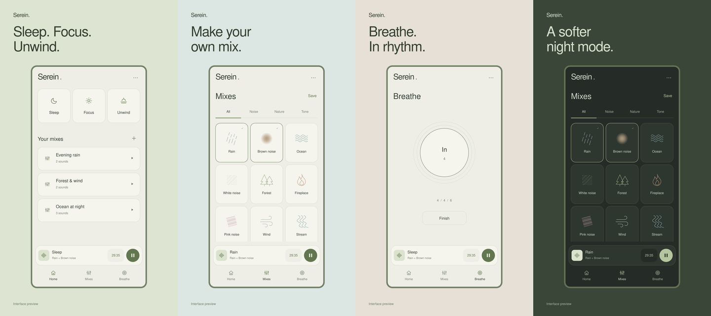

# Serein

A quiet space for sleep, focus, and unwinding. Serein is a native Android ambient sound mixer with twelve bundled soundscapes, saved mixes, a sleep timer, breathing exercises, and home-screen widgets.

[Download APK](https://github.com/0xAnto/serein/releases/latest/download/Serein.apk) · [All releases](https://github.com/0xAnto/serein/releases) · [Report a bug](https://github.com/0xAnto/serein/issues)

**Android 12 or newer · Fully offline · No account, ads, or analytics · MIT licensed**



*Promotional interface mockups; actual app appearance may vary.*

## Download and install

1. Open the [GitHub Releases page](https://github.com/0xAnto/serein/releases/latest).
2. Download **Serein.apk** under **Assets**. The source-code ZIP files are for developers.
3. Open the APK on your Android device. If prompted, allow your browser or file manager to install apps from this source, then tap **Install**.

Signed APKs are published by the release workflow after the maintainer configures signing and publishes a version. If there is no release yet, the first APK is still pending.

Future releases signed with the same key install as updates and retain your saved mixes and preferences. A development build signed with a different key must be uninstalled first; uninstalling removes local data. Each release includes `SHA256SUMS` for checking the download.

## Features

- **Twelve soundscapes:** rain, brown noise, ocean, white noise, forest, fireplace, pink noise, wind, stream, singing bowl, night, and soft fan.
- **Your own mixes:** combine sounds, adjust layer and master volumes, and save favorites. Sleep, Focus, and Unwind presets help you get started.
- **Sleep timer:** presets or a custom duration, with a fade included in the selected duration. Pausing playback pauses the timer too.
- **Background playback:** notification and lock-screen controls, Android audio focus, and playback that continues when you leave the app.
- **Breathe:** a guided 4 / 4 / 6 breathing cycle.
- **Widgets:** a 4 × 2 player and a 2 × 2 sleep widget with playback and timer controls.
- **Light and night themes:** layouts adapt to system insets and larger text.

Everything runs on your device. All audio is bundled, mixes are stored locally, and the app does not request internet access. Notification permission is used for playback controls.

## Using Serein

**Home** contains presets and saved mixes. Tap a mix to play it; long-press a saved mix to edit or delete it.

**Mixes** is the sound builder. Tap sounds to combine them. Tap the compact player's artwork or name to open layer volumes, master volume, Save, and the sleep timer. Tap an active countdown to change it.

**Breathe** provides the breathing guide. The top-right options menu contains the app theme setting and **Add widget**. The widget timer cycles through Off / 15 / 30 / 45 / 60 / 90 minutes. The Sleep widget starts a 30-minute session when no timer is selected.

Calls and competing audio apps follow Android audio focus. Swiping the activity away leaves active playback running; force-stopping the app stops it.

## Build from source

Java and Android framework views, `MediaPlayer`, `MediaSession`, and `RemoteViews`. No WebView or third-party app library dependencies.

Requirements: JDK 17, Android SDK Platform 36, and Android SDK Build Tools 36.0.0. Android Studio can install the SDK components. Gradle and the Android build plugin are downloaded on the first build.

```sh
git clone https://github.com/0xAnto/serein.git
cd serein
./gradlew assembleDebug
```

The development APK is at `app/build/outputs/apk/debug/app-debug.apk`. You can also open the project in Android Studio.

For a direct SDK build without Gradle:

```sh
export ANDROID_SDK_ROOT=/path/to/android-sdk
./build-apk.sh
```

This writes `build/Serein-Android.apk` and creates a local test key in the ignored `test-signing/` directory. Set `SEREIN_BUILD_TOOLS` to another installed build-tools directory if needed. Public releases use a separate private signing key.

## Verify and contribute

```sh
./tests/run.sh
```

Tests require JDK 17, Python 3, and FFprobe (from FFmpeg). They check timer formatting, gain bounds, fade math, manifest contracts, widgets, offline packaging, and all twelve audio assets. GitHub Actions also builds a debug APK on pushes and pull requests.

See [DEVICE-CHECK.md](DEVICE-CHECK.md) for playback, accessibility, and widget checks on a phone. Device behavior still needs manual verification.

Bug reports and pull requests are welcome. Include Android version, device model, app version, reproduction steps, and expected behavior in bug reports. Run the checks and describe any device testing with pull requests.

## Releases

Maintainer instructions for signing and publishing are in [RELEASING.md](RELEASING.md).

## License

[MIT](LICENSE), including the bundled original synthesized soundscapes.
